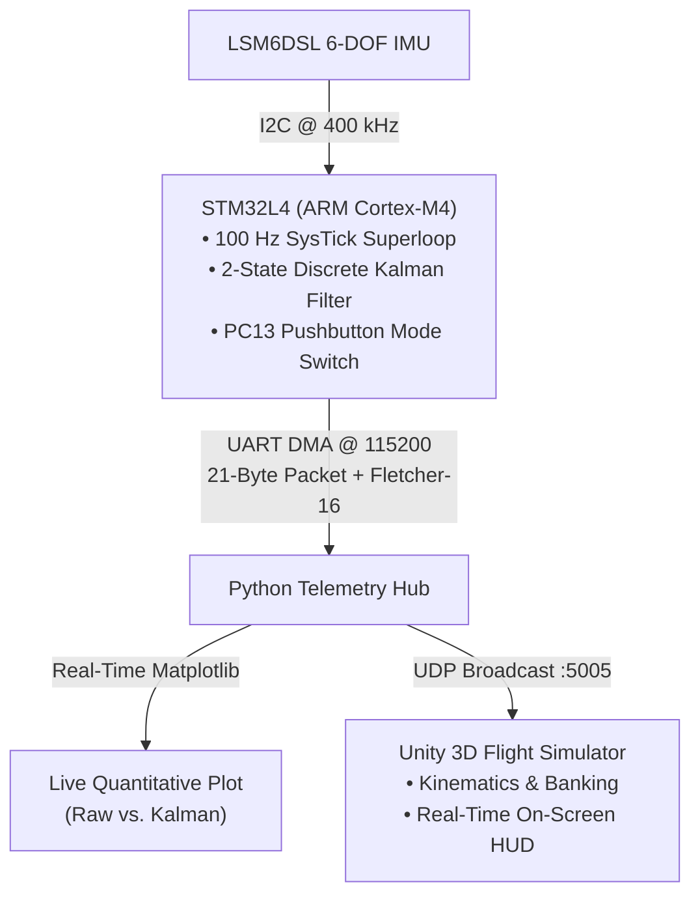

# stm32-flight-sim

-00599C?logo=c&logoColor=white)

## Overview
A real-time 6-DOF attitude estimation pipeline and interactive flight visualization testbench built on the **STM32L4** (ARM Cortex-M4) microcontroller. The system fuses raw accelerometer and gyroscope data from an onboard **LSM6DSL** IMU using a custom discrete 2-state Kalman filter, offloading packet transmission asynchronously via **UART DMA** with **Fletcher-16** checksum verification.

A Python-based telemetry broker ingests serial data, displays live quantitative Kalman vs. Raw orientation plots via Matplotlib, and re-broadcasts packets over local UDP loopback to drive a real-time 3D flight simulator in Unity.

## How to Run

### 1. Flash the Firmware
1. Open the project in `firmware/` using **STM32CubeIDE**.
2. Connect your STM32 board via USB.
3. Build and flash the binary to the microcontroller.
4. Verify your ST-Link Virtual COM port number in Windows Device Manager (e.g., `COM5`).

### 2. Start the Python Telemetry Hub (Run First)
Because Windows enforces exclusive COM port access, start the Python script first so it captures the serial stream:

python tools/telemetry_plotter_udp.py

The script opens `COM5`, launches real-time Matplotlib plots, and broadcasts validated frames to `127.0.0.1:5005` via UDP.

### 3. Launch the Visualizer

#### Option A: Run Standalone Executable (Fastest — No Unity Installation Required)
1. Download the latest build from the [Releases](../../releases) tab (or navigate to `build/`).
2. Run `FlightSim.exe`.
3. The simulator will automatically bind to UDP port `5005` and start receiving board telemetry.

#### Option B: Open Project in Unity Editor (Development Mode)
1. Open **Unity Hub** and select **Add project from disk**.
2. Select the `visualizer/` directory.
3. Open the main flight scene under `Assets/Scenes/`.
4. Ensure the `FlightSimBridge` component on `AircraftRoot` is set to listen on port `5005`.
5. Press **Play** in the Unity Editor.

### 4. Interactive Testing
- **Attitude Control:** Pitch and bank the STM32 board to maneuver the 3D aircraft.
- **Hardware Mode Switch:** Press the blue user button (**PC13**) on the board to toggle between **2-State Kalman Filtering** and **Raw Accelerometer** mode. The on-screen HUD and Matplotlib graphs will reflect the active mode and real-time noise response immediately.
